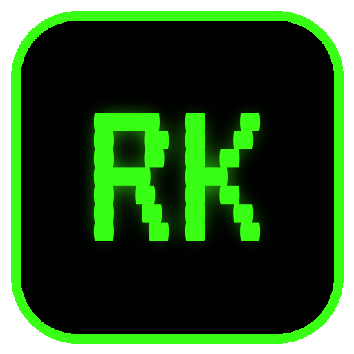
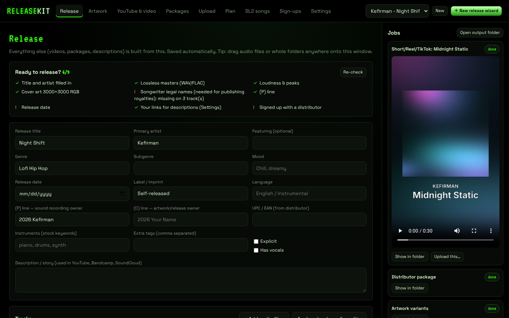
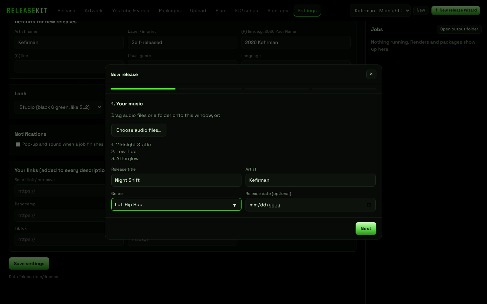
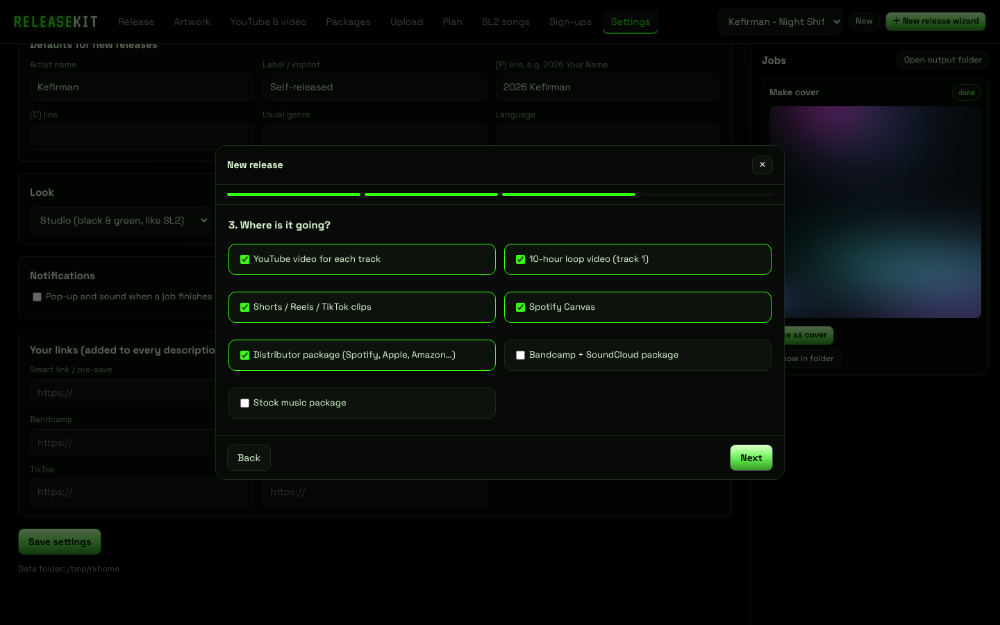
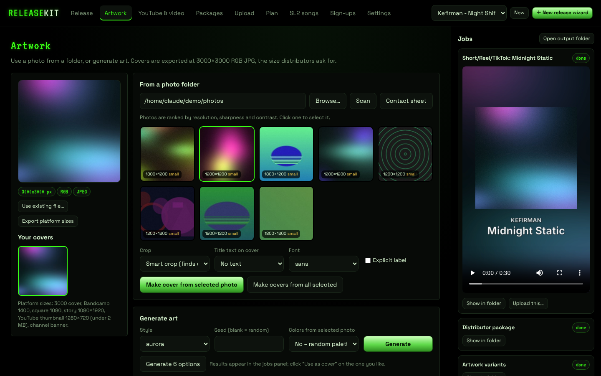
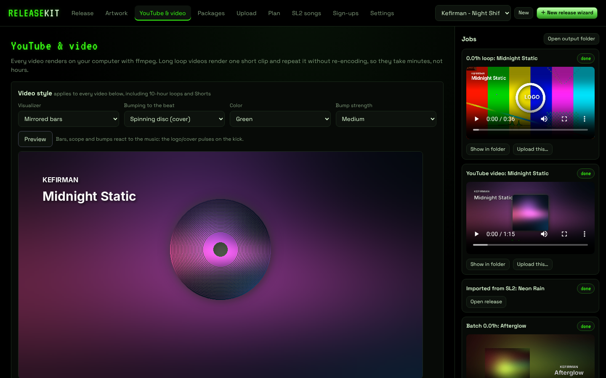
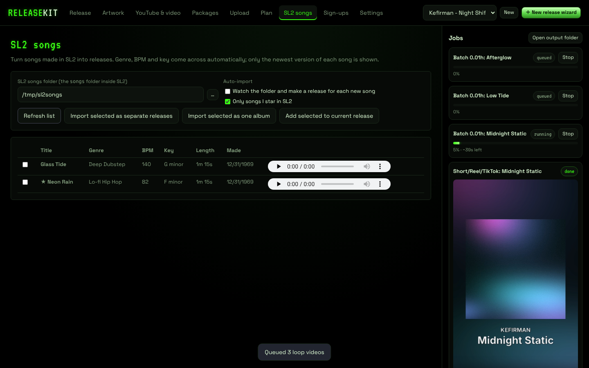
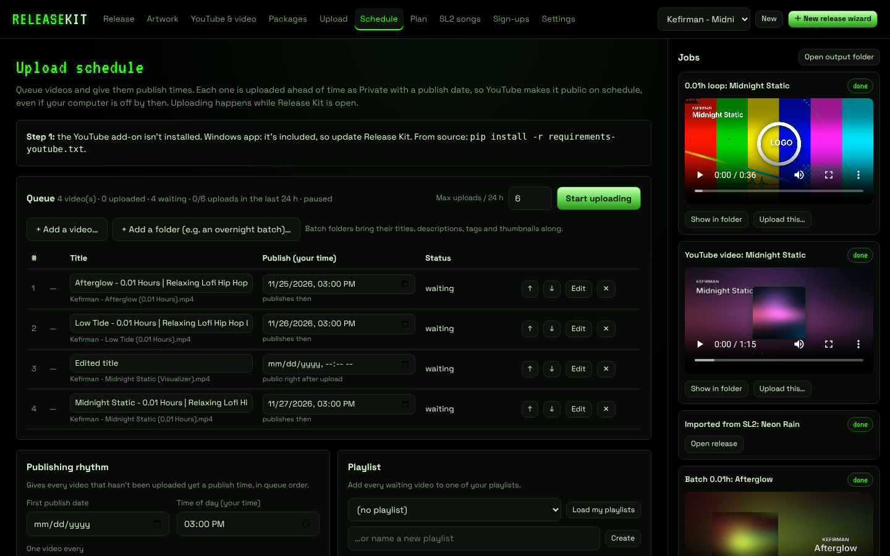
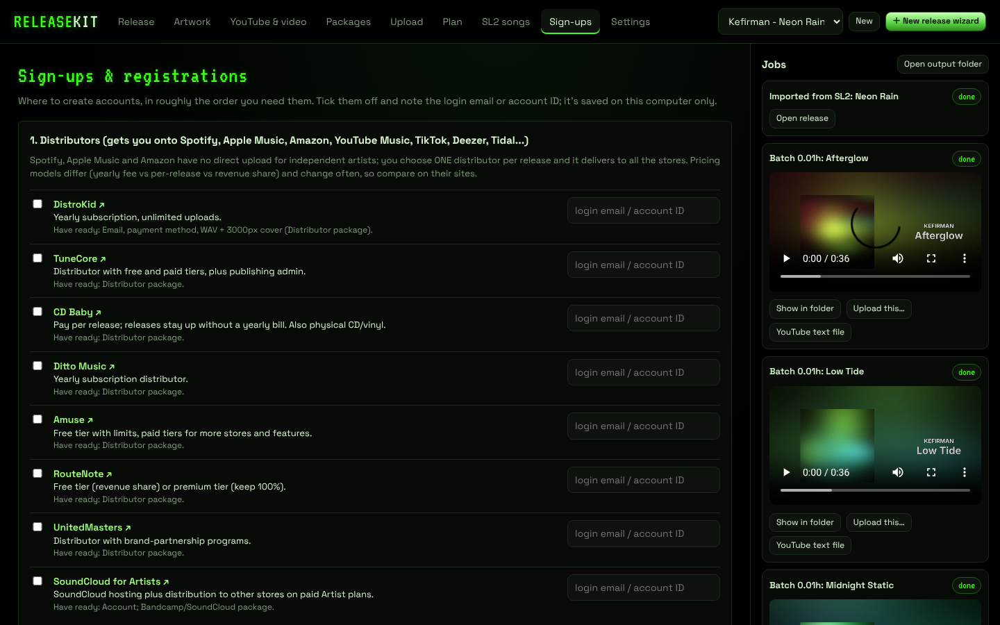

<p align="center"></p>

# Release Kit (SL2U)

**Release your music everywhere from one place.** Make covers, YouTube videos, 10-hour loops, Shorts and Spotify Canvases. Build upload-ready packages for distributors, Bandcamp, SoundCloud and stock sites. Upload to YouTube. Everything runs on your own computer.

Built as the companion uploader for **[SL2](https://github.com/kefirman9000/SL2)**: songs you star in SL2 can turn into releases automatically.



## Download (Windows)

**[⬇ Get the latest Windows release](https://github.com/kefirman9000/SL2U/releases/latest)**

1. Download `ReleaseKit-windows-x64.zip`.
2. Unzip it anywhere and double-click **`ReleaseKit.exe`**.
3. Your browser opens the app. Keep the black window open while you work; close it to quit.

No Python or ffmpeg install needed; ffmpeg is bundled. The first time, Windows may say "Windows protected your PC" because the app isn't code-signed: click **More info → Run anyway**.

Mac and Linux: see [Run from source](#run-from-source).

## Screenshots

| | |
|---|---|
|  |  |
| **New release wizard:** music, cover, where it's going, one button. | Tick the outputs you want; it queues everything. |
|  |  |
| **Artwork:** photos ranked from a folder, smart crops, generated art, cover history. | **Video style:** visualizers and a cover/disc/logo/text that bumps to the beat, with instant previews. |
|  |  |
| **SL2 songs:** import songs from SL2, or auto-import the ones you star. | **Schedule:** a publishing rhythm for your uploads, done ahead of time. |
|  | |
| **Sign-ups:** every distributor, store, stock library and royalty organization, with checkboxes. | |

## What it does

| Tab | What you get |
|---|---|
| **Release** | One form for title, artist, genre, mood, dates, (P)/(C) lines and UPC, plus per-track ISRC, credits, BPM, key and lyrics. A **Ready to release?** checklist flags what's missing. **Analyze** checks loudness (LUFS), true peak, sample rate and lossy sources, and estimates BPM. |
| **Artwork** | Pick a photo folder; photos are ranked by resolution, sharpness and contrast. Make a 3000×3000 cover (smart crop, center crop, or fit + blurred fill) with optional title text and explicit label, or **generate** art in 6 styles. Export every platform size. All your covers stay in a gallery. |
| **YouTube & video** | One **video style** for everything: visualizers (frequency bars, mirrored bars, waveform, line, circle scope, scrolling spectrum) in the colour of your choice, and a **cover, spinning disc, logo or title text that bumps to the kick**. Release videos, full-album videos with chapters, Shorts/Reels/TikTok, Spotify Canvas. **10-hour (1–12 h) loop videos** with a seamless loop point and backgrounds: still cover, slow zoom, slow pan, film grain/VHS, breathing glow, photo slideshow, **your own video clip** (looped by dissolving the end into the start, ping-pong, or straight repeat; crop or fit) or **a folder of clips**. **Overnight batch**: a loop video and paste-ready YouTube text for every track in a folder. |
| **Packages** | **Distributor** (WAV, cover, metadata.csv/json, lyrics, checklist), **Bandcamp + SoundCloud**, **Stock music** (WAVs, 60/30/15 s cut-downs, MP3s, keyword CSV), **Stock photo pack**. |
| **Upload** | YouTube title, description (with your links, credits, chapters, hashtags) and tags; upload now or add to the schedule. |
| **Schedule** | An upload queue with publish times: set a rhythm (one a day at 3 pm, every 12 hours…), pick or create a playlist, and import a whole overnight-batch folder with its titles, descriptions, tags and thumbnails. Videos upload ahead of time as Private with a publish date, so YouTube publishes them on time even if your computer is off. Stays under a daily upload cap and waits when YouTube's daily limit is hit. Includes help writing the YouTube API audit request. |
| **Plan** | A timeline worked back from your release date, downloadable as a calendar (.ics). |
| **SL2 songs** | Lists your SL2 songs (newest version of each) with genre, BPM and key. Import as singles, as one album, or into the current release. Turn on auto-import to make a release for every song you star. |
| **Sign-ups** | Links to distributors, artist-profile claims, stores, stock libraries, royalty organizations (ASCAP/BMI, The MLC, SoundExchange) and the YouTube API setup, with checkboxes and notes. |

**Ease of use:** drag and drop audio, photos or whole folders anywhere (titles, BPM, key and ISRC are read from the files' tags); saved defaults for new releases; remembered video settings; jobs that survive closing the app; optional pop-up and sound when a job finishes; disk-space check before long renders; plain-English error messages; Studio (black & green) and Ember themes.

## Run from source

1. **Python 3.10+** from python.org (Windows: tick "Add to PATH").
2. **ffmpeg**: Mac `brew install ffmpeg`, Windows `winget install Gyan.FFmpeg`, Linux `sudo apt install ffmpeg`.
3. Run `./start-mac-linux.sh` (Mac/Linux) or double-click `start-windows.bat`. The first start installs Flask, Pillow and numpy into `.venv`, then opens http://127.0.0.1:5577.

Your projects, settings and renders live in `~/ReleaseKit` (change the output folder in Settings).

## Connecting SL2

Open the **SL2 songs** tab and point it at SL2's `songs` folder (next to `sl2.py`, or wherever `SL2_HOME` points). Tick **Watch the folder** to auto-import. By default only songs you ★ in SL2 are imported, because SL2 saves every edit as a new version.

## Optional: YouTube uploads and the schedule

1. From source: `.venv/bin/pip install -r requirements-youtube.txt` (the Windows build already includes it).
2. Follow **Sign-ups → section 7**: enable YouTube Data API v3, create an OAuth client of type **Desktop app**, add yourself as a test user, and save the JSON as `~/ReleaseKit/client_secret.json`.
3. In the **Schedule** tab press **Connect YouTube** and sign in once.

Uploads from API projects Google hasn't audited are **Private only**, scheduled ones included: make them Public in YouTube Studio, or apply for an audit (the Schedule tab drafts the answers for you). Daily upload limits apply. Custom thumbnails need a verified channel.

## Updates

The Windows app checks GitHub for a new version when it starts and shows a banner. **Update now** downloads it, closes Release Kit, swaps in the new files and reopens it; your releases, settings and renders aren't touched. Turn the check off in Settings. Running from source, the banner links to the release instead.

## Good to know

- **Spotify, Apple Music, Amazon Music, YouTube Music, TikTok, Deezer and Tidal only take music through a distributor.** Upload the Distributor package to one distributor and it delivers everywhere.
- **Content ID vs stock libraries:** if you license a track on stock sites or use it as a free background loop, opt it **out** of YouTube Content ID at your distributor.
- **Shutterstock Music** buys all rights outright; those tracks can't be used or sold anywhere else afterwards.
- Most stock libraries and PROs don't accept fully AI-generated music.

## How 10-hour videos stay fast

The audio loop is built once, with its tail crossfaded into its own start so there's no click at each repeat, then looped and encoded to AAC in one pass. The picture is a short clip rendered once and stream-copied. Most of the time is the audio encode: roughly 5–20 minutes for 10 hours, and about 2.5 GB at 1080p.

With a visualizer or a bumping element, one full loop of picture is rendered against the music and repeated. That loop is trimmed to a whole number of video frames, so picture and beat stay locked together for the full 10 hours, and the spinning disc makes whole turns per loop so it never jumps. This adds roughly the length of one loop to the render time.

## Building the Windows release

Every push to `main` runs [.github/workflows/windows-release.yml](.github/workflows/windows-release.yml): it builds `ReleaseKit.exe` with PyInstaller on Windows, bundles ffmpeg, starts the app and renders a test video, then publishes the zip as a GitHub Release when the version in `releasekit/__init__.py` is new. To ship an update, bump that number and push.

## Layout

```
releasekit/
  app.py        web server, job queue, uploads, readiness checks, SL2 import
  audio.py      analysis, conversions, cut-downs, seamless loops
  art.py        photo ranking, crops, generated art, text, variants
  video.py      all video renderers
  packages.py   platform export folders
  meta.py       titles, descriptions, tags, keywords, timeline, .ics
  sl2link.py    reads SL2's songs folder
  links.py      sign-up directory (plain data: edit it freely)
  youtube.py    YouTube API uploader
  schedule.py   upload queue and background uploader
  update.py     update check and self-update
  ff.py         ffmpeg helpers (finds a bundled copy first)
  templates/index.html   the interface
  static/fonts/ Space Grotesk + VT323 (SIL Open Font License)
packaging/      Windows build launcher and release notes
```
